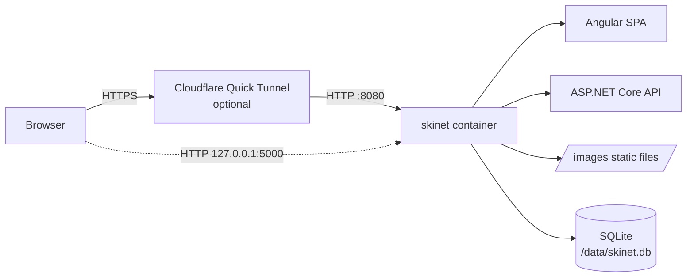

<p align="center">
  
</p>

<h1 align="center">SkiNet</h1>

<p align="center">
  Snow sports gear catalog built with Angular 21 and ASP.NET Core 10, served from a single Docker image.
</p>

<p align="center">
  
  
  
  
</p>

SkiNet is a compact e-commerce sample that demonstrates a clean ASP.NET Core API, specification/repository patterns over EF Core, and an Angular SPA. The API and frontend are hosted under **one origin** and shipped as **one application image**; SQLite data lives in a Docker volume. A separate, optional `cloudflared` container can publish the app through a Cloudflare Quick Tunnel for short-lived test deployments.

## Highlights

- **One image, one origin** — Angular, `/api/*`, and `/images/*` are served by the same ASP.NET Core process on port `8080`.
- **Catalog API** — paging, brand/type filters, name search, and price sorting.
- **Production-safe defaults** — Swagger and the deliberate error endpoints are available only in Development; unknown API routes stay `404` instead of falling back to the SPA.
- **Root-relative images** — product image URLs such as `/images/products/sb-ang1.png` work behind any hostname, including random Quick Tunnel URLs.
- **Persistent SQLite** — EF Core migrations and seed data run on startup; the database is stored in a named volume at `/data`.
- **Optional Quick Tunnel** — an opt-in Compose overlay with Cloudflare Email PIN protection.
- **Tested** — xUnit integration tests plus a container smoke test that verifies HTML, JSON, images, API 404s, and SQLite persistence.

## Tech stack

| Layer | Technology |
|---|---|
| Frontend | Angular 21, Bootstrap 5, ngx-bootstrap, Font Awesome |
| API | ASP.NET Core 10, AutoMapper, Swashbuckle |
| Data | EF Core 10, SQLite, specification + repository patterns |
| Tests | xUnit, `Microsoft.AspNetCore.Mvc.Testing`, WebApplicationFactory |
| Runtime | Multi-stage Docker build, Docker Compose, optional Cloudflare Quick Tunnel |

## Architecture



| Route | Served by |
|---|---|
| `/`, `/assets/*`, client-side routes | Angular build copied into `wwwroot` |
| `/api/products`, `/api/products/{id}`, `/api/products/brands`, `/api/products/types` | ASP.NET Core controllers |
| `/images/products/*` | `API/wwwroot/images` static files |
| `/swagger` | Development only |
| `/api/buggy/*` | Development only |

## Getting started

### Prerequisites

- [.NET SDK 10](https://dotnet.microsoft.com/download)
- [Node.js](https://nodejs.org/) 22 or 24, with npm 10+
- [Docker](https://docs.docker.com/get-docker/) and Docker Compose v2+ for the containerized flow

### Run with Docker (recommended)

```bash
git clone <repo-url> && cd skinet
docker compose up -d --build

curl -i http://127.0.0.1:5000/
curl -i 'http://127.0.0.1:5000/api/products?pageSize=5'
```

The app is published only on `127.0.0.1:5000`; it is not exposed on public interfaces. See [DEPLOY.md](DEPLOY.md) for upgrades, backups, rollback, and troubleshooting.

### Run locally

Start the API:

```bash
dotnet restore
dotnet run --project API
# API: https://localhost:5001 (HTTP: http://localhost:5000)
```

Start the Angular dev server in another terminal:

```bash
cd client
npm ci

# The dev server expects TLS files at client/ssl/
mkdir -p ssl
openssl req -x509 -newkey rsa:2048 -nodes \
  -keyout ssl/server.key -out ssl/server.crt -days 365 \
  -subj "/CN=localhost"

npm start
# UI: https://localhost:4200
```

> [!NOTE]
> `client/ssl/` is gitignored. Generate the certificate once, or provide your own. The dev environment points Angular at `https://localhost:5001/`, and the API allows the `https://localhost:4200` origin. The dev server also proxies `/images` to the API so root-relative product images resolve during local development.

## Configuration

| Setting | Default | Notes |
|---|---|---|
| `ConnectionStrings:DefaultConnection` | `Data source=skinet.db` | Override in Docker with `ConnectionStrings__DefaultConnection` |
| `ASPNETCORE_URLS` | `http://+:80` in the legacy image, `http://+:8080` in the unified image | Compose sets `8080` |
| `ASPNETCORE_ENVIRONMENT` | `Production` in Compose | Swagger and buggy endpoints are enabled only in `Development` |
| `TUNNEL_ALLOWED_EMAIL` | — | Comma-separated email addresses allowed through the Quick Tunnel |

Docker uses `Data source=/data/skinet.db`; the Compose volume `skinet-data` (actual name usually `skinet_skinet-data`) is mounted at `/data`. `.env` is gitignored; start from [`.env.example`](.env.example).

## API reference

| Method | Endpoint | Description |
|---|---|---|
| `GET` | `/api/products` | Paged catalog. Query: `pageIndex`, `pageSize` (default `6`, max `50`), `brandId`, `typeId`, `search`, `sort` (`priceAsc`, `priceDesc`) |
| `GET` | `/api/products/{id}` | Single product; `404` when missing |
| `GET` | `/api/products/brands` | Product brands |
| `GET` | `/api/products/types` | Product types |
| `GET` | `/images/products/{file}` | Product image |

```bash
curl 'http://127.0.0.1:5000/api/products?pageSize=1&sort=priceAsc'
```

```json
{
  "pageIndex": 1,
  "pageSize": 1,
  "count": 18,
  "data": [
    {
      "id": 8,
      "name": "Green React Woolen Hat",
      "description": "Suspendisse dui purus, scelerisque at, vulputate vitae, pretium mattis, nunc. Mauris eget neque at sem venenatis eleifend. Ut nonummy.",
      "price": 8,
      "pictureUrl": "/images/products/hat-react1.png",
      "productType": "Hats",
      "productBrand": "React"
    }
  ]
}
```

Swagger is available at `https://localhost:5001/swagger` in Development only.

## Testing

```bash
# .NET unit + integration tests
dotnet test skinet.sln -c Release

# Angular lint and production build
cd client
npm run lint
npm run build -- --configuration production
cd ..

# Container smoke test (build the image first)
docker build -t skinet:local -f Dockerfile .
./scripts/docker-smoke-test.sh skinet:local
```

The smoke test checks `/`, `/api/products`, `/images/products/*`, a missing `/api` route, and SQLite persistence across a container recreation using a volume marker.

## Deployment

The normal deployment is one application container plus a persistent volume:

```bash
docker compose up -d --build
```

To expose it through a Cloudflare Quick Tunnel:

```bash
cp .env.example .env
# Set TUNNEL_ALLOWED_EMAIL in .env

docker compose -f docker-compose.yml -f docker-compose.tunnel.yml up -d --build
docker compose -f docker-compose.yml -f docker-compose.tunnel.yml logs --tail=100 cloudflared
```

> [!WARNING]
> Quick Tunnel is intended for testing only. The URL changes when the tunnel restarts, there is no uptime guarantee, concurrent requests are capped, and SSE is not supported. Keep the Email PIN protection enabled and never expose ports `80`, `443`, or `5000` directly.

See [DEPLOY.md](DEPLOY.md) for the full VPS procedure, backup/restore commands, legacy rollback path, and troubleshooting.

## Project structure

```text
API/              ASP.NET Core Web API, controllers, middleware, SPA hosting
API.Tests/        xUnit unit and integration tests
Core/             Entities, repository interfaces, specifications
Infrastructure/   EF Core context, repositories, migrations, seed data
client/           Angular 21 SPA
scripts/          Docker smoke and SQLite persistence test
Dockerfile        Multi-stage Angular + .NET image
docker-compose.yml
docker-compose.tunnel.yml
DEPLOY.md         Deployment, backup, and recovery guide
```

## Data and persistence

- The database is SQLite at `/data/skinet.db` inside the container.
- On startup the API applies EF Core migrations and seeds brands, types, and products when the tables are empty.
- The seed dataset contains 18 products, 6 brands, and 4 types.
- Container recreation keeps the named volume; `docker compose down -v` deletes it. Do not use `down -v` for routine deployments.

## Security notes

- Swagger and `BuggyController` are gated to the Development environment.
- Unknown `/api/*` paths and `/swagger` plus `/swagger/*` return `404`, even in Production; the SPA fallback cannot turn them into `200 HTML`.
- The API returns root-relative image URLs and rejects traversal, backslashes, absolute URLs, and dangerous schemes.
- Production does not perform HTTP-to-HTTPS redirection inside the container; TLS is terminated by Cloudflare Tunnel.
- CORS is limited to `https://localhost:4200` for local development; the unified deployment is same-origin.
- Never commit `.env`, database files, certificates, or tunnel tokens.

## Known limitations

- Quick Tunnel is a POC mechanism, not a production ingress.
- SQLite is single-node; this sample does not implement replication or multi-instance sharing.
- The Angular UI is a starter catalog view; authentication, cart, checkout, and order workflows are not implemented.
- External Quick Tunnel, Email PIN, and HTTPS verification require manual browser testing with a Cloudflare-reachable deployment.
