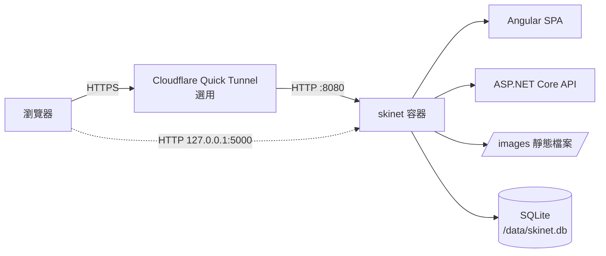

<p align="center">
  
</p>

<h1 align="center">SkiNet</h1>

<p align="center">
  以 Angular 21 與 ASP.NET Core 10 打造的雪上運動裝備目錄，並以單一 Docker Image 提供服務。
</p>

<p align="center">
  
  
  
  
</p>

SkiNet 是一個精簡的電子商務範例，示範乾淨的 ASP.NET Core API、以 EF Core 實作的規格（Specification）與儲存庫（Repository）模式，以及 Angular SPA。API 與前端在同源下提供，並打包成單一應用程式 Image；SQLite 資料存放於 Docker Volume。另一個獨立的選用 `cloudflared` 容器可透過 Cloudflare Quick Tunnel 發佈應用程式，適合短期測試部署。

## 重點特色

- **單一 Image、同源提供** — Angular、`/api/*` 與 `/images/*` 都由同一個 ASP.NET Core 程序在連接埠 `8080` 提供。
- **商品目錄 API** — 支援分頁、品牌／類型篩選、名稱搜尋與價格排序。
- **安全的正式環境預設值** — Swagger 與刻意觸發錯誤的端點僅在 Development 環境提供；未知 API 路由維持 `404`，不會退回 SPA。
- **根路徑相對圖片** — 商品圖片網址如 `/images/products/sb-ang1.png` 可適用於任何主機名稱，包括隨機的 Quick Tunnel 網址。
- **SQLite 持久化** — 啟動時執行 EF Core 移轉與種子資料寫入；資料庫存放於掛載到 `/data` 的具名 Volume。
- **選用 Quick Tunnel** — 需主動啟用的 Compose overlay，並具備 Cloudflare Email PIN 保護。
- **已測試** — 包含 xUnit 整合測試，以及驗證 HTML、JSON、圖片、API 404 與 SQLite 持久化的容器冒煙測試。

## 技術堆疊

| 層級 | 技術 |
|---|---|
| 前端 | Angular 21、Bootstrap 5、ngx-bootstrap、Font Awesome |
| API | ASP.NET Core 10、AutoMapper、Swashbuckle |
| 資料 | EF Core 10、SQLite、規格與儲存庫模式 |
| 測試 | xUnit、`Microsoft.AspNetCore.Mvc.Testing`、WebApplicationFactory |
| 執行環境 | 多階段 Docker 建置、Docker Compose、選用 Cloudflare Quick Tunnel |

## 架構



| 路由 | 提供者 |
|---|---|
| `/`、`/assets/*`、客戶端路由 | 複製到 `wwwroot` 的 Angular 建置產物 |
| `/api/products`、`/api/products/{id}`、`/api/products/brands`、`/api/products/types` | ASP.NET Core 控制器 |
| `/images/products/*` | `API/wwwroot/images` 靜態檔案 |
| `/swagger` | 僅 Development |
| `/api/buggy/*` | 僅 Development |

## 開始使用

### 前置需求

- [.NET SDK 10](https://dotnet.microsoft.com/download)
- [Node.js](https://nodejs.org/) 22 或 24，搭配 npm 10+
- [Docker](https://docs.docker.com/get-docker/) 與 Docker Compose v2+（容器化流程）

### 使用 Docker 執行（建議）

```bash
git clone <repo-url> && cd skinet
docker compose up -d --build

curl -i http://127.0.0.1:5000/
curl -i 'http://127.0.0.1:5000/api/products?pageSize=5'
```

應用程式只發佈於 `127.0.0.1:5000`，不會暴露在公開網路介面。升級、備份、回復與疑難排解請參閱 [DEPLOY.md](DEPLOY.md)。

### 本機執行

啟動 API：

```bash
dotnet restore
dotnet run --project API
# API：https://localhost:5001（HTTP：http://localhost:5000）
```

在另一個終端機啟動 Angular 開發伺服器：

```bash
cd client
npm ci

# 開發伺服器預期 TLS 檔案位於 client/ssl/
mkdir -p ssl
openssl req -x509 -newkey rsa:2048 -nodes \
  -keyout ssl/server.key -out ssl/server.crt -days 365 \
  -subj "/CN=localhost"

npm start
# UI：https://localhost:4200
```

> [!NOTE]
> `client/ssl/` 已列入 gitignore。憑證只需產生一次，或改用你自己的憑證。開發環境會讓 Angular 指向 `https://localhost:5001/`，而 API 允許 `https://localhost:4200` 來源。開發伺服器也會將 `/images` 代理到 API，因此根路徑相對的商品圖片可在本機開發時正常顯示。

## 設定

| 設定 | 預設值 | 說明 |
|---|---|---|
| `ConnectionStrings:DefaultConnection` | `Data source=skinet.db` | 在 Docker 中以 `ConnectionStrings__DefaultConnection` 覆寫 |
| `ASPNETCORE_URLS` | 舊版 Image 為 `http://+:80`，單一 Image 為 `http://+:8080` | Compose 設為 `8080` |
| `ASPNETCORE_ENVIRONMENT` | Compose 中為 `Production` | Swagger 與 buggy 端點僅在 `Development` 啟用 |
| `TUNNEL_ALLOWED_EMAIL` | — | 允許通過 Quick Tunnel 的電子郵件地址，以逗號分隔 |

Docker 使用 `Data source=/data/skinet.db`；Compose Volume `skinet-data`（實際名稱通常為 `skinet_skinet-data`）會掛載到 `/data`。`.env` 已列入 gitignore；請從 [`.env.example`](.env.example) 開始設定。

## API 參考

| 方法 | 端點 | 說明 |
|---|---|---|
| `GET` | `/api/products` | 分頁商品目錄。查詢參數：`pageIndex`、`pageSize`（預設 `6`，上限 `50`）、`brandId`、`typeId`、`search`、`sort`（`priceAsc`、`priceDesc`） |
| `GET` | `/api/products/{id}` | 單一商品；找不到時回傳 `404` |
| `GET` | `/api/products/brands` | 商品品牌 |
| `GET` | `/api/products/types` | 商品類型 |
| `GET` | `/images/products/{file}` | 商品圖片 |

```bash
curl 'http://127.0.0.1:5000/api/products?pageSize=1&sort=priceAsc'
```

```json
{
  "pageIndex": 1,
  "pageSize": 1,
  "count": 18,
  "data": [
    {
      "id": 8,
      "name": "Green React Woolen Hat",
      "description": "Suspendisse dui purus, scelerisque at, vulputate vitae, pretium mattis, nunc. Mauris eget neque at sem venenatis eleifend. Ut nonummy.",
      "price": 8,
      "pictureUrl": "/images/products/hat-react1.png",
      "productType": "Hats",
      "productBrand": "React"
    }
  ]
}
```

Swagger 僅在 Development 環境提供，網址為 `https://localhost:5001/swagger`。

## 測試

```bash
# .NET 單元與整合測試
dotnet test skinet.sln -c Release

# Angular lint、單元測試與正式建置
cd client
npm run lint
npm test -- --watch=false
npm run build -- --configuration production
cd ..

# 容器冒煙測試（先建置 Image）
docker build -t skinet:local -f Dockerfile .
./scripts/docker-smoke-test.sh skinet:local
```

冒煙測試會檢查 `/`、`/api/products`、`/images/products/*`、不存在的 `/api` 路由，以及容器重建後 SQLite 是否透過 Volume 標記保持持久化。

## 部署

一般部署為一個應用程式容器加上一個持久化 Volume：

```bash
docker compose up -d --build
```

若要透過 Cloudflare Quick Tunnel 對外提供：

```bash
cp .env.example .env
# 在 .env 設定 TUNNEL_ALLOWED_EMAIL

docker compose -f docker-compose.yml -f docker-compose.tunnel.yml up -d --build
docker compose -f docker-compose.yml -f docker-compose.tunnel.yml logs --tail=100 cloudflared
```

> [!WARNING]
> Quick Tunnel 僅供測試使用。Tunnel 重新啟動後網址會改變，不提供可用性保證，同時請求數有上限，且不支援 SSE。請保持 Email PIN 保護啟用，並切勿直接暴露 `80`、`443` 或 `5000` 連接埠。

完整 VPS 部署流程、備份／還原指令、舊版回復路徑與疑難排解請參閱 [DEPLOY.md](DEPLOY.md)。

## 專案結構

```text
API/              ASP.NET Core Web API、控制器、中介軟體、SPA 託管
API.Tests/        xUnit 單元與整合測試
Core/             實體、儲存庫介面、規格
Infrastructure/   EF Core context、儲存庫、移轉、種子資料
client/           Angular 21 SPA
scripts/          Docker 冒煙與 SQLite 持久化測試
Dockerfile        Angular + .NET 多階段 Image
docker-compose.yml
docker-compose.tunnel.yml
DEPLOY.md         部署、備份與回復指南
```

## 資料與持久化

- 資料庫位於容器內的 SQLite 檔案 `/data/skinet.db`。
- 啟動時 API 會套用 EF Core 移轉，並在資料表為空時寫入品牌、類型與商品種子資料。
- 種子資料包含 18 個商品、6 個品牌與 4 個類型。
- 容器重建會保留具名 Volume；`docker compose down -v` 會刪除它。例行部署請勿使用 `down -v`。

## 安全性說明

- Swagger 與 `BuggyController` 僅限 Development 環境使用。
- 未知的 `/api/*` 路徑，以及 `/swagger` 與 `/swagger/*`，即使在 Production 也會回傳 `404`；SPA fallback 不會把它們變成 `200 HTML`。
- API 回傳根路徑相對的圖片網址，並拒絕路徑穿越、反斜線、絕對 URL 與危險 scheme。
- Production 不會在容器內執行 HTTP 到 HTTPS 的重新導向；TLS 由 Cloudflare Tunnel 終止。
- CORS 僅限本機開發用的 `https://localhost:4200`；單一 Image 部署為同源，不需要放寬。
- 切勿提交 `.env`、資料庫檔案、憑證或 Tunnel token。

## 已知限制

- Quick Tunnel 是 POC 機制，不是正式環境入口。
- SQLite 為單節點；此範例未實作複寫或多實例共用。
- Angular UI 為入門版商品目錄檢視；尚未實作驗證、購物車、結帳與訂單流程。
- Quick Tunnel、Email PIN 與 HTTPS 的外部驗證需要可連線 Cloudflare 的部署環境，並以瀏覽器手動測試。

## 參考資源

- [Learn to build an e-commerce app with .NET Core and Angular](https://www.udemy.com/course/learn-to-build-an-e-commerce-app-with-net-core-and-angular/) — 本專案所依據的 Udemy 課程。
